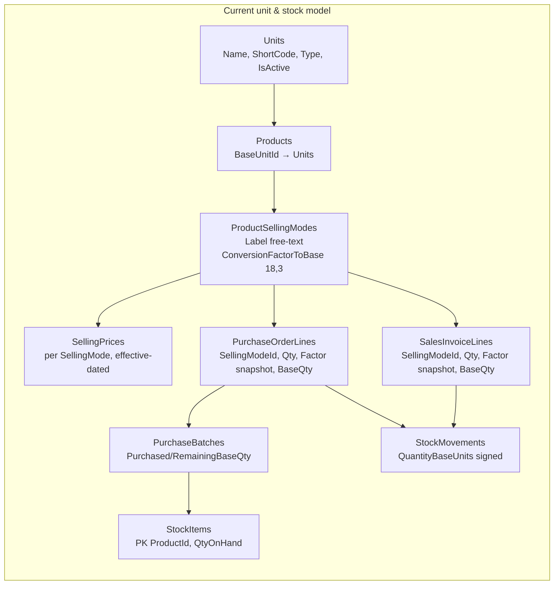
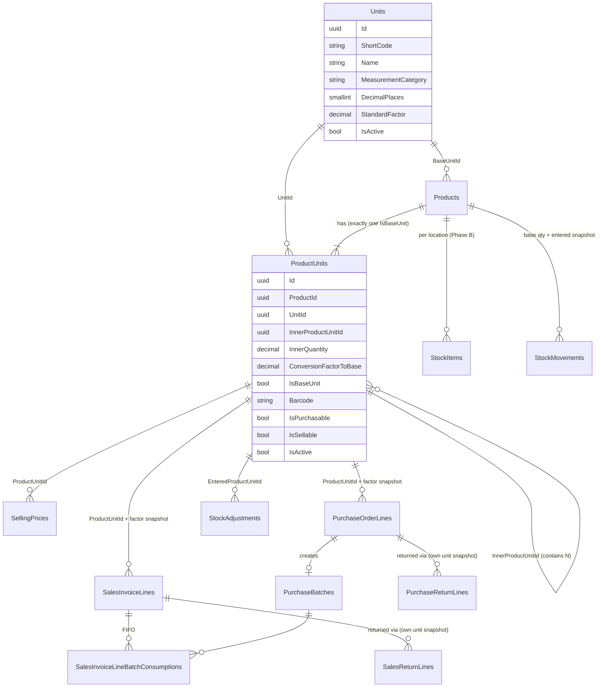
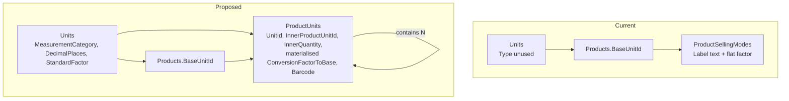
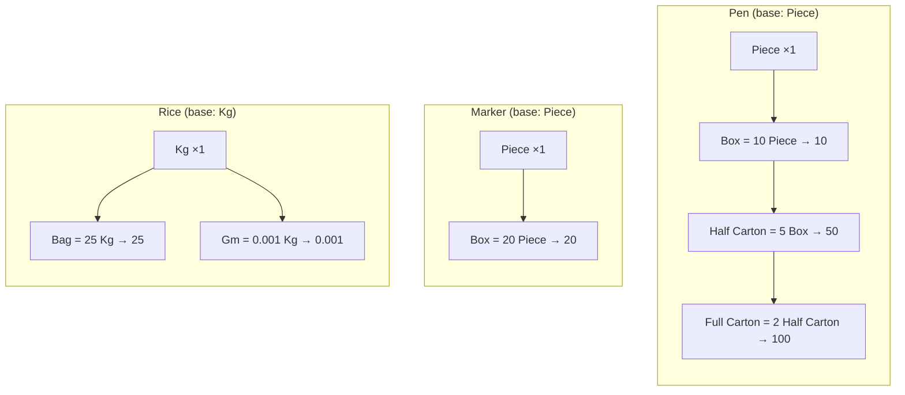
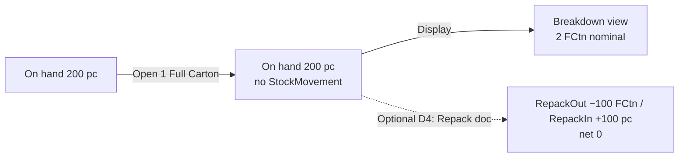

# Sellora Billing: Unit Master, Product Unit Conversion and Stock Lifecycle Restructuring Analysis

| | |
|---|---|
| Document type | Architecture analysis and restructuring proposal (analysis only, nothing implemented) |
| Repository state analysed | branch `analyse`, migrations up to `20260920114635_AddIdempotencyKeysAndCancelledBy` |
| Date | 2026-11-04 |
| Status | **Awaiting approval.** No source, schema, migration or data change has been made. |

Path conventions: `BE/` = `backend/src/`, `FE/` = `frontend/src/app/`, `TESTS/` = `backend/tests/Sellora.Tests/`.

---

## 1. Executive summary

**The main finding: Sellora already uses base-unit stock.** The proposed restructuring therefore extends an existing model; it does not replace it.

The codebase already has:

- `Product.BaseUnitId`, a foreign key to `Units`.
- A single conversion level, `ProductSellingMode.ConversionFactorToBase` (the "10 kg bag" = 10 kg kind).
- The proposed snapshot pattern on both transaction lines. `PurchaseOrderLine` and `SalesInvoiceLine` already store `Qty` (entered), `SellingModeId` (entered unit), `ConversionFactorToBase` (snapshot) and `BaseQty`.
- Base units for all stock state: `StockItems.QuantityOnHand`, `StockMovements.QuantityBaseUnits`, `PurchaseBatches.PurchasedBaseQty/RemainingBaseQty`, and `SalesInvoiceLineBatchConsumptions.QtyBaseUnits`.
- FIFO batch costing, row-level locking (`StockLocks.LockStockItemsAsync`, `FOR UPDATE`) and a no-negative-stock rule.

**What is missing:**

| # | Gap | Severity |
|---|---|---|
| G1 | No packaging hierarchy. Every selling mode is a flat factor to base, with no parent/child relationship. | High |
| G2 | A selling mode is a free-text `Label` with no `UnitId`. Product packaging is not linked to the Unit Master. | High |
| G3 | `UnitType` is stored but never validated: no category compatibility and no whole-number rule for countable units. | High |
| G4 | Precision is too low. The factor is `numeric(18,3)`, so it cannot hold 1 g = 0.001 kg chains or 1/12 ratios. Base unit cost is `numeric(18,4)`, which loses precision when a carton price is divided by 100+. | Medium |
| G5 | A mode's factor can be edited after use (`ProductService.ReconcileSellingModesAsync`, lines 105-106). History is safe because of the snapshots, but the `SellingPrice` attached to that mode silently changes meaning. | High |
| G6 | Returns are validated in the original line's unit, so you cannot return 3 pieces from a box line. Unit labels are read live, not snapshotted. | Medium |
| G7 | Stock adjustments and opening stock accept base units only. The stock ledger has no entered-unit snapshot. | Medium |
| G8 | **No branch, warehouse or location concept exists.** `StockItems` has primary key `ProductId` (one global pool). Transfers, per-branch stock and allocation do not exist. | Critical for the hypermarket target. It is a separate foundation, not part of the unit work. |
| G9 | No barcodes at product, packaging or batch level. | Medium |
| G10 | Weak quality gates. Tests use EF InMemory only, so locks and check constraints are never exercised. CI does not run `dotnet test`. Migrations auto-apply at startup (`Program.cs:88`). | High (delivery risk) |

**Recommendation in one paragraph.** Evolve `ProductSellingMode` in place into a hierarchical `ProductUnit` (table `ProductUnits`) and keep every existing row Id. Then `SellingPrices`, `PurchaseOrderLines` and `SalesInvoiceLines` foreign keys stay valid with zero data rewrite.

- Each `ProductUnit` references a global `Unit` and its **inner** product unit, with an `InnerQuantity` ("1 Box contains 10 Piece").
- The flattened `ConversionFactorToBase` is materialised, and the row becomes immutable once used.
- Extend `Units` into a true Unit Master with `MeasurementCategory` (adding `Packaging` and `Length`), a decimal-places rule, and an optional standard factor for physical units (g to kg).
- Keep every stock table in base units. That is already true and correct.
- Add entered-unit snapshots to adjustments, returns and the ledger.
- Treat **multi-branch inventory as its own foundation phase**. Transfers cannot be built on today's schema.

---

## 2. Analysis scope and limitations

**Scope.** I read the complete backend (Domain, Infrastructure, Api, all 18 migrations, DbSeeder), every Angular feature that touches products, units, purchases, sales, stock, pricing, reports or dashboard, the test project, CI workflow and `docs/phase-1-implementation-plan.md`. Six specialist reviews (Database, Product, Purchase, Sales, Inventory, Impact/Test) ran in parallel. I reconciled their findings and spot-verified them against the code.

**Limitations.**

- No database was queried. **Production and dev data volumes and the actual contents of `ProductSellingModes.Label` are unknown.** The migration mapping (§22) needs a data profiling step before it is finalised.
- Nothing was built or run. Line numbers are as of the analysed commit.
- I did not unpack the design handoff (`docs/sellora-billing-design-handoff.zip`), so UI proposals follow the existing component conventions, not a new design.
- The business documents referenced in code comments ("docx §9.3, §17") are not in the repository.

---

## 3. Existing architecture and implementation

A modular monolith in clean-ish layers:

```
BE/Sellora.Domain          Entities, enums, service interfaces, input models (no EF)
BE/Sellora.Infrastructure  SelloraDbContext, IEntityTypeConfiguration per aggregate, Services/*, Migrations
BE/Sellora.Api             Controllers (some contain query/report logic directly), Contracts (DTO records), RBAC
FE/                        Standalone Angular components per feature; signals + reactive forms; shared/ui kit
```

- **Write paths** go through domain services (`ProductService`, `PurchaseService`, `SalesService`, `StockAdjustmentService`, `PricingService`).
- **Read and report paths** are LINQ queries written inside controllers (`StockController`, `ReportsController`, `DashboardController`, `SalesController.Catalog`, `PricingController.List`). **This matters for impact:** quantity display logic lives in controllers, not in a shared read service.



---

## 4. Existing database schema (verified)

Naming: PascalCase quoted identifiers, plural tables from DbSet names, `PK_/FK_/IX_/CK_` constraint names, `uuid` ids generated in the application, enums stored as strings. There is no soft delete beyond `IsActive`, **no concurrency tokens**, and no `CreatedAt` on masters.

### 4.1 Unit and product tables (created in `20260917133530_AddBasicMasters`, never altered)

| Table | Column | Type | Notes |
|---|---|---|---|
| Units | Id | uuid PK | |
| | Name | varchar(60) | unique `IX_Units_Name` (case-sensitive in DB; API checks case-insensitively) |
| | ShortCode | varchar(10) | unique `IX_Units_ShortCode` |
| | Type | varchar(20) | enum `UnitType { Weight, Volume, Count, Other }`; **not used by any logic** |
| | IsActive | bool | |
| Products | BaseUnitId | uuid FK → Units (Restrict) | change blocked once stock history exists (`ProductService.cs:63-69`) |
| | ReorderLevel | numeric(18,3) | implicitly in base units |
| ProductSellingModes | ProductId | uuid FK (Cascade) | |
| | Label | varchar(60) | free text, **not unique per product, no UnitId** |
| | ConversionFactorToBase | numeric(18,3) | API `[Range(0.001, …)]` |
| | IsActive | bool | |
| SellingPrices | ProductSellingModeId | uuid FK (Cascade) | `Price numeric(18,4)`, `EffectiveFrom/To` |

### 4.2 Quantity columns (all `numeric(18,3)`, base units unless stated)

| Table | Columns |
|---|---|
| StockItems (PK ProductId) | QuantityOnHand, AverageCost (18,4) |
| StockMovements | QuantityBaseUnits (signed), PurchaseBatchId?, ReferenceType/Id/No |
| PurchaseOrderLines | Qty (entered), ConversionFactorToBase (snapshot), BaseQty, Rate (per entered unit, 18,4), UnitCost (per base unit, 18,4) |
| PurchaseBatches | PurchasedBaseQty, RemainingBaseQty, UnitCost (18,4); `CK_PurchaseBatches_RemainingWithinPurchased` |
| PurchaseReturnLines | Qty (in original line's unit), BaseQty, `CK_…Qty_Positive` |
| SalesInvoiceLines | Qty, ConversionFactorToBase, BaseQty, UnitPrice (per entered unit), CostOfGoodsSold |
| SalesInvoiceLineBatchConsumptions | QtyBaseUnits, ReturnedQtyBaseUnits, UnitCost; `CK_SalesConsumption_ReturnedWithinConsumed` |
| SalesReturnLines | Qty (in original line's unit), BaseQty |
| StockAdjustments | QuantityBaseUnits, BeforeQty, AfterQty, UnitCost? |

**Not found:** Branch, Warehouse, Location, Company or Tenant tables or columns; barcode columns; expiry or manufacture dates on batches; transfer documents; stock-take documents.

---

## 5. Existing backend implementation

| Concern | Where | Behaviour |
|---|---|---|
| Unit CRUD | `BE/Sellora.Api/Controllers/UnitsController.cs` (`api/v1/units`: GET, POST, PUT `{id}`, POST `{id}/status`) | Duplicate Name/ShortCode check. **No in-use guard** on update or deactivate. No GET by id. |
| Product upsert | `BE/Sellora.Infrastructure/Services/ProductService.cs` | `ValidateReferencesAsync` checks the unit exists but **not that it is active**. `ReconcileSellingModesAsync` matches modes by id, **updates factor in place**, deactivates referenced removed modes and deletes unreferenced ones. |
| Purchase | `PurchaseService.BuildLineAsync` (~617-691), `ApplyPurchaseLineToStockAsync` (~693-734) | `baseQty = Qty × mode.Factor`, `UnitCost = Taxable / BaseQty`. One batch per line. Movement +BaseQty. StockItem upsert with moving average. **Does not check `mode.IsActive`.** Purchase is "Completed" on create; there is no GRN or draft. |
| Purchase return | `PurchaseService.CreateReturnAsync` (~351-514) | Qty in the line's unit, `returnable = line.Qty − Σprior.Qty`, base ≤ `batch.RemainingBaseQty`. |
| Purchase cancel | `CancelPurchaseAsync` (~516-586) | Only if batches are untouched. Writes a `Purchase` movement with a negative quantity. |
| Sale | `SalesService.CreateSaleAsync` (12-104), `BuildLineAsync` (483-533), `ConsumeBatchesFifoAsync` (556-592) | Sums base quantity per product across lines, locks, refuses if over on-hand, then FIFO by `CreatedAt, BatchSequence`. **UnitPrice comes from the client and is not validated against `SellingPrices`.** Does not check `mode.IsActive`. |
| Sale return | `SalesService.CreateReturnAsync` (268-409) | Returns to the exact consumed batches. Validation is in the line's unit. |
| Sale cancel | `CancelSaleAsync` (411-466) | Writes a movement of type `Sale` with a positive quantity (no distinct type). |
| Adjustment | `StockAdjustmentService.CreateAdjustmentAsync` | Types Damage, Loss, Expiry, Correction, OpeningStock. Base units only. An increase creates a batch; a decrease is FIFO (duplicate of the sales FIFO code). |
| Precision guard | `StockQuantity.EnsureStorable` (`BE/Sellora.Infrastructure/Services/StockLocks.cs`) | Rejects base quantities with more than 3 decimal places. |
| Concurrency | `StockLocks` | READ COMMITTED with `FOR UPDATE` on StockItems in id order, plus advisory locks for document numbers and idempotency. **There is no row to lock on a product's first stock-in.** |
| Pricing | `PricingService.SetPriceAsync`, `PricingController` (`api/v1/pricing/{sellingModeId}`) | Price is per mode. Cost per unit = `AverageCost × factor`. |
| Reports | `ReportsController.CurrentStock` (15-87), `StockMovement` (102-139), `DashboardController` (71-91) | Base quantity plus `BaseUnit.ShortCode`. Selling value = price of the smallest-factor mode ÷ factor. |

---

## 6. Existing Angular implementation

| Feature | Files | Unit-relevant behaviour |
|---|---|---|
| Units master | `FE/features/masters/units/{unit-form,unit-list,units.models.ts,units.service.ts}`; routes `administration/units[/new\|/:id/edit]` | Name, shortCode and type (hard-coded list). Required validators only. Edit mode loads the whole list and finds the unit client-side. |
| Product form | `FE/features/inventory/products/product-form/*` | `baseUnitId` select (active units, not filtered by type, **not locked after history**). `sellingModes` FormArray with `label` + `conversionFactorToBase` (`step=0.001`, `min 0.001`). **No preview.** |
| Pricing | `FE/features/inventory/pricing/*` | One row per active mode: cost per unit, price, margin, history modal. |
| Purchase form | `FE/features/purchases/purchase-form/*` | Product select, then mode select (**inactive modes listed**), qty `step 0.001`, preview of base qty and unit cost per base unit. |
| Purchase return | `FE/features/purchases/purchase-returns/purchase-return-form/*` | Qty in the line's unit, capped at `returnableQty`, which can be fractional. |
| POS | `FE/features/sales/pos/pos.{ts,html}` | Client-side search by name or SKU (placeholder mentions barcode, which **does not exist**). Mode select, qty `step 0.001`, editable price. Aggregates base quantity per product to flag over-stock lines. |
| Sales return | `FE/features/sales/sales-returns/sales-return-form/*` | Qty in the sold unit. |
| Stock | `FE/features/inventory/stock/{stock-overview,stock-detail,stock.models.ts}` | Base quantity shown with `toFixed(2)` while storage has 3 decimals. **Bug:** `StockMovementType` union lacks `SaleReturn`/`PurchaseReturn` (`stock.models.ts:2`). |
| Adjustment | `FE/features/inventory/stock-adjustments/stock-adjustment-form/*` | `quantityBaseUnits` only. No list page. |
| Reports and dashboard | `FE/features/reports/{current-stock-report,stock-movement-report}`, `FE/features/dashboard/dashboard-page` | Base quantity plus `baseUnitLabel`. |

Frontend tests: only `FE/app.spec.ts`.

---

## 7. Business requirements (consolidated)

1. A global, reusable Unit Master: code, name, measurement category, active flag.
2. Per product: exactly one **base stock unit**, plus any number of packaging or alternative units.
3. Packaging is **hierarchical**. The user defines each direct relationship once (Box = 10 Piece, Half Carton = 5 Box, Full Carton = 2 Half Carton) and the system derives every conversion to base recursively.
4. The same unit (Box) can have different contents per product (10 or 20 pieces).
5. Weight, volume and length units convert within their category (Kg/Gm, L/mL). Packaging can wrap any base category ("Bag" = 25 kg).
6. Every transaction keeps its entered quantity, entered unit and the conversion used, so history never changes.
7. All stock state stays in base units and remains consistent across purchase, sale, return, adjustment, transfer and repack.
8. Different prices per unit (Piece, Box, Carton).
9. Hypermarket readiness: branches, transfers, barcodes per packaging level, batch traceability.

---

## 8. Recommended Unit Master architecture

Evolve `Units`; do not replace it. Keep the Id and the table name.

| Field | Change | Purpose |
|---|---|---|
| Id | keep | |
| Code | **keep column `ShortCode`**, expose as `code` in new DTO fields later (optional rename) | Unique code (kg, pc, box, hctn, fctn) |
| Name | keep | Display name |
| MeasurementCategory | **rename `Type` → `MeasurementCategory`**; enum `Count, Weight, Volume, Length, Packaging` (migrate `Other` → `Packaging` after review) | Compatibility rules |
| DecimalPlaces | **new** `smallint` 0..3 (Count/Packaging default 0; Weight/Volume/Length default 3) | Whole-number enforcement (no 0.5 Piece) |
| StandardFactor | **new** `numeric(28,10)` nullable; set only for Weight/Volume/Length relative to the category reference (kg = 1, g = 0.001; L = 1, mL = 0.001; m = 1, cm = 0.01) | Lets the product form **suggest** Gm↔Kg automatically. It is not product-specific, so it does not violate the rule against putting product factors on global units. |
| IsActive | keep, add **in-use guard**: cannot deactivate a unit used by an active product unit; cannot change category or StandardFactor once used | Integrity |
| CreatedAt/UpdatedAt | optional, only if the audit initiative adopts them globally | |

Category semantics:

- **Count**: discrete base items (Piece, Nos, Pair). Can be a base unit.
- **Weight / Volume / Length**: measurable. Can be a base unit, and also a non-base unit only when the category equals the base category.
- **Packaging**: containers (Box, Pack, Half Carton, Full Carton, Bag, Case). **Never a base unit.** Can wrap any category.

---

## 9. Recommended Product Unit configuration architecture

### 9.1 Entity

Rename `ProductSellingMode` to **`ProductUnit`**, table `ProductSellingModes` to **`ProductUnits`**, and **keep all Ids.** It already serves purchases as well as sales, so "selling mode" is a misnomer.

| Column | Type | Rule |
|---|---|---|
| Id | uuid | preserved from the existing mode |
| ProductId | uuid FK (Cascade → **Restrict**) | |
| UnitId | uuid FK → Units (Restrict) | **new**; replaces free-text Label as identity |
| InnerProductUnitId | uuid FK → ProductUnits, nullable | the unit this one **contains** (Box → Piece). NULL only for the base row |
| InnerQuantity | numeric(18,6) | how many inner units one of this unit contains (> 0) |
| ConversionFactorToBase | numeric(28,10) | **materialised** product of `InnerQuantity` up the chain; recomputed by the service, never entered |
| IsBaseUnit | bool | exactly one per product; `UnitId = Product.BaseUnitId`, factor = 1 |
| Label | varchar(60) nullable | **kept** as an optional display override ("10 kg bag"); defaults to Unit.Name |
| Barcode | varchar(50) nullable | packaging-level GTIN/EAN (§14) |
| IsPurchasable / IsSellable | bool | drives purchase and POS dropdowns |
| IsDefaultPurchaseUnit / IsDefaultSalesUnit | bool | at most one each per product |
| SortOrder | smallint | display order (derived from depth by default) |
| IsActive | bool | |

**Naming note.** The proposal's `ParentUnitId` is ambiguous: in the Pen example the "parent" of Box is Piece, which is really the *child* content. Use **`InnerProductUnitId` + `InnerQuantity`** ("1 Box contains 10 Piece"). Point it at the **ProductUnit** row, not the global Unit, so the chain is guaranteed to stay inside the same product.

### 9.2 Constraints

- `UNIQUE (ProductId, UnitId)`: a unit appears once per product.
- Partial unique index `(ProductId) WHERE "IsBaseUnit"`: one base row per product.
- `CHECK ("IsBaseUnit" = ("InnerProductUnitId" IS NULL))`.
- `CHECK ("InnerQuantity" > 0 AND "ConversionFactorToBase" > 0)`, and `CHECK (NOT "IsBaseUnit" OR ("InnerQuantity" = 1 AND "ConversionFactorToBase" = 1))`.
- Same-product chain: an alternate key `(ProductId, Id)` and a composite FK `(ProductId, InnerProductUnitId) → ProductUnits(ProductId, Id)`.
- Partial unique `(Barcode) WHERE Barcode IS NOT NULL`.
- Cycle-freedom and category compatibility cannot be expressed as a CHECK. **The service enforces them** (§10.3), protected by the product-level lock (§13.6).

### 9.3 Immutability rule (fixes G5)

A `ProductUnit` referenced by any transaction line, adjustment or movement has **immutable** `UnitId`, `InnerProductUnitId`, `InnerQuantity` and `ConversionFactorToBase`. To change a pack size, deactivate the old row and add a new one. Price history moves with it explicitly.

This matters because otherwise one `ProductUnit` Id would mean "Box of 10" on old invoices and "Box of 12" on new ones. Snapshots protect quantities, but not prices, reports grouped by unit, or barcode meaning.

---

## 10. Hierarchical conversion logic

### 10.1 Algorithm

```
factor(base) = 1
factor(u)    = u.InnerQuantity × factor(u.Inner)
```

- Computed on save for the whole product graph (a topological walk from the base). Results are stored in `ConversionFactorToBase`.
- Runtime transactions **never recurse**. They read the materialised factor and copy it into the line snapshot.
- Converting between any two units is `qty × factor(from) / factor(to)`. The UI uses this only for previews and breakdowns.

### 10.2 Worked examples

| Case | Base | Rows (Unit ← Inner × InnerQty) | Factors to base |
|---|---|---|---|
| Pen | Piece | Box ← Piece×10; Half Carton ← Box×5; Full Carton ← Half Carton×2 | 1 / 10 / 50 / 100 |
| Product A | Piece | Box ← Piece×10 | Box = 10 |
| Product B | Piece | Box ← Piece×20 (same global `Box` unit) | Box = 20 |
| Full carton of half cartons | Piece | Full Carton ← Half Carton×2 (Half Carton ← Box×6 ← Piece×12) | 144 |
| Rice | Kg | Gm ← Kg×0.001 (suggested from StandardFactor); Bag ← Kg×25 | Gm = 0.001, Bag = 25 |
| Oil | Litre | mL ← Litre×0.001; Bottle ← mL×500; Case ← Bottle×12 | 0.001 / 0.5 / 6 |
| Plain item | Piece | base row only | 1 |

Base-unit choice guidance: when a product is mostly sold in grams, prefer **Gm** as the base. Base quantities then stay integral and `numeric(18,3)` never truncates. Kg as base remains valid, because 1 g = 0.001 kg fits 3 dp.

### 10.3 Validation rules (service-level, `ProductUnitConfigurationValidator`)

1. Exactly one base row. Its unit is `Product.BaseUnitId`, and its category is not `Packaging`.
2. Every non-base row has an Inner in the same product, and the walk from any row reaches the base in at most N steps (N = row count). This gives **cycle detection** (visited set) and **orphan detection**.
3. Category compatibility:
   - A `Packaging` unit may wrap anything.
   - A Weight, Volume or Length unit must share the base unit's category.
   - A `Count` unit may be non-base only when the base is `Count` (e.g. Dozen over Piece).
4. If both a unit and its inner have `StandardFactor`, then `InnerQuantity` **must equal** `unit.StandardFactor / inner.StandardFactor`. This prevents "1 g = 0.002 kg".
5. Whole-number rule: if the base unit has `DecimalPlaces = 0`, every `ConversionFactorToBase` must be an integer. A box of 2.5 pieces is impossible.
6. Duplicate equivalence warning (not error): two units with the same factor (Box = 10, Pack = 10) are allowed, but flagged.
7. Factor bounds: the derived factor is at most 10^9 and at least 10^-6, so overflow and absurd chains are rejected.
8. Units must be active. Rows referenced by history are immutable (§9.3). The base unit is immutable once stock history exists (the existing rule is kept).

### 10.4 Precision and rounding

| Item | Today | Proposed | Reason |
|---|---|---|---|
| InnerQuantity | (n/a) | numeric(18,6) | supports 0.001 and 0.5 |
| ConversionFactorToBase (master + line snapshots) | 18,3 | **numeric(28,10)** | chained products of fractional factors; exact for practical chains |
| Base quantities (stock, ledger, batches) | 18,3 | **keep 18,3** | `EnsureStorable` already rejects inexact base quantities. Countable bases are forced integral by the DecimalPlaces rule. |
| Entered quantity | 18,3 | keep 18,3, and validate against `Unit.DecimalPlaces` | no 0.5 Box unless the unit allows it |
| Per-base-unit cost (`PurchaseOrderLine.UnitCost`, `PurchaseBatch.UnitCost`, `StockItem.AverageCost`, consumption `UnitCost`) | 18,4 | **numeric(18,6)** | carton ₹1,234.56 ÷ 144 needs more than 4 dp to avoid COGS drift |
| Money totals | 18,2 / 18,4 | unchanged | |

Rounding policy:

- `BaseQty = EnteredQty × Factor` must be exactly representable at 3 dp. Otherwise reject (the existing behaviour).
- Never round base quantities silently.
- Money is rounded only at the line total (existing convention). Conversions apply only to quantity, never to money.

---

## 11. Purchase impact analysis

**Where conversion happens:** in `PurchaseService.BuildLineAsync`, once, at line build. Batches, movements and StockItem receive only `BaseQty`. That is already the case.

| Scenario | Today | Target |
|---|---|---|
| 1. Purchase 2 Full Cartons | works if a mode "Full Carton = 100" exists | line: Entered 2 × FCtn, factor 100, BaseQty 200 → batch 200 pc |
| 2. Purchase 5 Boxes | same | factor 10, BaseQty 50 |
| 3. Purchase 10 Pieces | same | factor 1, BaseQty 10 |
| 4. Buy in one unit, sell in another | works; batch is unit-agnostic | unchanged |
| 5. Receive in a different unit from the PO | **not applicable**: there is no PO/GRN split, purchase = receipt (`PurchaseStatus` has only `Completed`/`Cancelled`) | receive is the same document today. If a PO/GRN split is introduced later, the GRN line carries its own entered-unit snapshot and matches the PO in base quantity. |
| 6. Purchases with different packaging configs over time | works through the snapshot | with immutability (§9.3), "Box of 10" and "Box of 12" become different `ProductUnit` rows, so reports stay meaningful |
| 7. Return previously received stock | qty only in the purchased unit; returnable can show 0.37 Carton | return line gets its **own** entered unit, factor and qty. Validate `Σ BaseQty ≤ line.BaseQty` and `≤ batch.RemainingBaseQty`. Prorate credit by `baseQty / line.BaseQty`. |

Required changes:

- `PurchaseOrderLine`:
  - rename `SellingModeId` → `ProductUnitId` (column rename, same values);
  - add snapshots `UnitId` and `UnitCode` (varchar 10);
  - widen the factor;
  - add `RatePerBaseUnit` (derived, stored for reporting).
- `PurchaseReturnLine`: add `ProductUnitId`, `ConversionFactorToBase` and `UnitCode` snapshots. Existing rows are backfilled from the parent line.
- `BuildLineAsync`: check `ProductUnit.IsActive && IsPurchasable`, enforce the DecimalPlaces of the entered unit, and widen the cost precision.
- `PurchasesController.Returnable` (~line 223): return base quantity plus the list of allowed units.
- Pricing: `Rate` stays per entered unit, and `UnitCost` stays per base unit (already correct). No price conversion master is needed for purchases.

Batch quantities: one batch per line in base units (kept). A future mixed line ("2 cartons + 5 boxes") should be entered as two lines; the UI can offer a mixed-quantity helper that expands into separate lines.

---

## 12. Sales impact analysis

| Scenario | Target behaviour |
|---|---|
| 1. Buy 1 Full Carton (100), sell 2 Boxes | line 2 × Box, factor 10, BaseQty 20. FIFO takes 20 from the carton batch. Stock 80. |
| 2. Sell 5 Pieces | line 5 × Piece, BaseQty 5. Fractional pieces are rejected (DecimalPlaces 0). |
| 3. Sell one complete Box | 1 × Box, BaseQty 10 |
| 4. Sell loose pieces | the base row is always sellable unless disabled |
| 5. Multiple units in one invoice | already supported: base quantities are aggregated per product before the stock check (`SalesService.cs:52-79`); keep this |
| 6. Return a sold Box | return line has its own unit. Allow returning 1 Box or 3 Pieces against a Box line, validated in base quantity against `line.BaseQty − Σprior.BaseQty`. Restore to the consumed batches (existing logic). |
| 7. Different prices per unit | already modelled: `SellingPrice` per mode, which becomes per `ProductUnit` (same Ids) |

Required changes:

- **Unit selection in the POS:** the `SalesController.Catalog` DTO returns `ProductUnits` where `IsSellable && IsActive`, with factor, price, barcode and default flag. Scanning a packaging barcode selects that unit directly.
- **Pricing:**
  - Keep explicit per-unit prices.
  - **Add a server-side price check** in `SalesService.BuildLineAsync`. Today the client sends `UnitPrice` unchecked. Snapshot `ListUnitPrice`, and allow an override only with permission (e.g. `Sales.PriceOverride`).
  - Optional fallback: when a unit has no price, derive it as base price × factor. This is an open decision (§27).
- **Stock deduction:** unchanged (base-unit FIFO).
- **History:** add `UnitId` and `UnitCode` snapshots to `SalesInvoiceLine`. The label is read live from the mode today (`SalesController.ToDetail`).
- **Fractional quantities:** validate entered quantity against `Unit.DecimalPlaces`, and set the POS input `step` from it.
- **Cancellation:** introduce a `SaleCancellation` movement type instead of a positive `Sale`.
- **Discounts and promotions:** only a fixed line `Discount` exists. **No promotion engine was found.** Future promotions must key on `ProductUnitId` (e.g. "Box price") and evaluate quantity in base units.

---

## 13. Stock lifecycle impact analysis

### 13.1 Quantity field strategy

| Field | Responsibility | Lives on |
|---|---|---|
| EnteredQuantity | what the user typed | all document lines (existing `Qty`), plus **new** on StockAdjustment, return lines (own unit), transfer lines |
| EnteredProductUnitId | which product unit was used | existing `SellingModeId` (renamed), plus new where above |
| UnitCode snapshot | label stability | all document lines (new) |
| ConversionFactorSnapshot | factor at transaction time | existing `ConversionFactorToBase` on lines, plus new where above |
| BaseQuantity | the only quantity stock maths uses | existing `BaseQty` / `QuantityBaseUnits` everywhere |
| BaseUnitId | **not** stored per line | derivable from Product and immutable after history (`ProductService.cs:63-69`), so storing it adds no integrity. Only add it if the base-unit immutability rule is ever relaxed. |

`StockMovement` gains **nullable** `EnteredQuantity`, `EnteredProductUnitId` and `ConversionFactorSnapshot`. These are for audit and the movement report ("2 Box = 20 pc"). They are null for historical rows. It also gains `LocationId` in the branch phase. Balance-after is **not** recommended: under concurrent inserts it needs serialisation, and it can be computed in reports with window functions.

### 13.2 New or clarified movement types

`StockMovementType` additions: `PurchaseCancellation`, `SaleCancellation`, `TransferOut`, `TransferIn`, `OpeningStock` (split from `Adjustment`), and `Damage` / `Loss` / `Expiry` (or keep `Adjustment` with `AdjustmentType`; recommended: keep `Adjustment`, and add a `ReasonCode` column copied from `AdjustmentType` for reporting). Enums are stored as strings, so additions are non-breaking. Update the frontend union (`stock.models.ts:2`), which is already missing two values.

### 13.3 Packaging breakdown vs consumption

**Opening a carton is not a stock movement.** Stock is one base-unit pool per product (and per location later). Opening a Full Carton changes neither total nor value, so it **writes no ledger row**.

Display "breakdown" (e.g. 122 pc = 1 FCtn + 2 Box + 2 pc) is a **computed view**: greedy decomposition over sellable units, largest first. It is nominal, not a physical count.

Tracking sealed vs loose packs physically (needed only if cartons are scanned as sealed units in a warehouse) requires a separate *packaging state* sub-ledger. **Not recommended for this restructure** (open decision §27-D4). If it is required later, use a `Repack` document whose two legs net to zero base quantity: `RepackOut` −100 (FCtn), `RepackIn` +100 (pieces).

### 13.4 Scenario walk-through (single store today; transfer needs Phase B)

Setup: Pen, base Piece. FCtn = 2 HCtn, HCtn = 5 Box, Box = 10 pc, so FCtn = 100 pc.

| # | Operation | Document line (entered) | StockMovement (base) | On hand at Branch A | Batch B1 remaining |
|---|---|---|---|---|---|
| 1 | Receive 2 Full Cartons | Purchase: 2 × FCtn, factor 100 | +200 Purchase | 200 | 200 |
| 2 | Open one Full Carton | none (or optional audit note) | **none** | 200 | 200 |
| 3 | Sell 2 Boxes | Sale: 2 × Box, factor 10 | −20 Sale (consumes B1) | 180 | 180 |
| 4 | Sell 5 loose Pieces | Sale: 5 × pc, factor 1 | −5 Sale | 175 | 175 |
| 5 | Transfer 1 Half Carton to Branch B | Transfer: 1 × HCtn, factor 50 | −50 TransferOut @A (B1); +50 TransferIn @B (B1 at B, same cost) | 125 (B: 50) | A:125 / B:50 |
| 6 | Damage 3 Pieces | Adjustment Damage: 3 × pc | −3 Adjustment (FIFO B1) | 122 | 122 |

Invariant check: 200 − 20 − 5 − 50 − 3 = **122 at A** and 50 at B, so the company total is 172 = 200 − 28 sold or damaged.

The nominal breakdown at A is "1 FCtn, 2 Box, 2 pc". **Physically** there are 1 sealed FCtn and 22 loose pieces, which cannot be known without D4.

### 13.5 Branch transfer: dependency

There is **no location dimension** (G8). Branch transfers need:

- a `Locations` (Branch/Warehouse) master;
- `StockItems` re-keyed to `(ProductId, LocationId)`;
- batch remaining tracked per location (new `BatchLocationBalances(PurchaseBatchId, LocationId, RemainingBaseQty)`, or a split batch per location);
- `LocationId` on movements, purchases, sales and adjustments;
- a `StockTransfer` document (Draft → Dispatched/In-transit → Received; variance handling on receipt);
- locks keyed on (product, location);
- per-location reorder levels;
- user-to-branch scoping in RBAC;
- every stock query in `StockController`, `ReportsController` and `DashboardController` (currently one StockItem per product).

This is a **foundation project equal in size to the unit work**. It must be designed together with the unit work so new columns don't need a second migration. It should be delivered as its own phase (Phase B in §25).

### 13.6 Concurrency and consistency

- Keep READ COMMITTED with `FOR UPDATE` on StockItems in id order.
- **Fix the first-stock race.** Create the `StockItem` row (QOH 0) when the product is created, or `INSERT … ON CONFLICT DO NOTHING` before locking. Today two concurrent first purchases or adjustments for a new product lock nothing.
- Product-unit configuration edits take a `FOR UPDATE` lock on the `Products` row, so two edits cannot both pass cycle validation.
- Consolidate the duplicated FIFO code (`SalesService.ConsumeBatchesFifoAsync`, `StockAdjustmentService.ConsumeBatchesFifoAsync`) into one `BatchAllocator`, so transfers and damage reuse it.
- Negative stock stays disallowed (current rule). A per-location policy flag can be introduced later only if the business explicitly wants it.

---

## 14. Batch and barcode integration impact

- **Batches stay unit-agnostic** (base quantity plus cost per base unit). A batch received as cartons and sold as pieces needs no conversion state. `PurchaseBatch` gains nothing unit-related, except an optional `ReceivedProductUnitId` for traceability display (derivable via the PO line, so not needed).
- **Missing for hypermarket traceability:** `ExpiryDate` / `ManufactureDate` on batches (FEFO is impossible today), and batch per location (§13.5).
- **Barcodes (not found anywhere):**
  - `ProductUnit.Barcode` (GTIN-13/14 per packaging level: the piece EAN differs from the carton ITF-14). Scanning resolves product, unit and factor in one lookup. This needs a new endpoint, `GET api/v1/products/by-barcode/{code}`, or a catalog index.
  - Optional `ProductUnitBarcodes` child table if multiple barcodes per unit are needed (supplier variants). Recommended later, not now.
  - Weighed-item barcodes (price/weight-embedded EAN-13 prefix 2x) are an open decision. They need a parser keyed on the PLU of the base row.
  - Batch-level barcodes (GS1-128 with lot and expiry) are out of scope until batch expiry exists.

---

## 15. Reporting impact

| Report / view | File | Impact |
|---|---|---|
| Current stock | `ReportsController.CurrentStock` (15-87), `FE/features/reports/current-stock-report` | Quantity stays base. Add a computed breakdown column. **Selling value** logic (lines 57-74, smallest-factor price ÷ factor) should use the base `ProductUnit` price when set, or the documented fallback. |
| Stock movement | `ReportsController.StockMovement` (102-139) | Add entered qty, unit and factor (nullable for history). Add location later. |
| Stock overview / detail | `StockController` (17-58, 76-126), `FE/features/inventory/stock/*` | `unitId` filter keeps its meaning (base unit). Show the breakdown. Fix `toFixed(2)`: format with the base unit's DecimalPlaces. Fix the movement-type union. |
| Dashboard | `DashboardController` (71-91) | Stock value `QOH × AverageCost` stays valid (both per base unit). Low stock is per location later. |
| Purchase / sales / profit | `ReportsController` (141-232) | Money-only; unaffected. Unit-wise sales quantity reports (by `ProductUnit`) become possible through the line snapshots. |
| Pricing grid | `PricingController.List` | Cost per unit = `AverageCost × ConversionFactorToBase` (unchanged formula, new precision). Show the hierarchy order. |
| Accounts reports | `AccountsReportsController` | Unaffected. |

No report sums quantities **across** products, so there is no mixed-unit aggregation risk today. Keep this rule: cross-product quantity sums are forbidden, and only value may be aggregated.

---

## 16. Existing vs proposed comparison

| Area | Existing implementation | Identified gap | Proposed change | Impact |
|---|---|---|---|---|
| Unit Master | `Unit {Name, ShortCode, Type, IsActive}`; `UnitsController` CRUD; `UnitType` unused; seeded kg/litre/box/pc (`DbSeeder.cs:188-194`) | No category semantics, no decimal rule, no Packaging category, no in-use guard | `MeasurementCategory` (+Packaging, Length), `DecimalPlaces`, `StandardFactor`, in-use guards, GET by id | Medium |
| Product Master | `Product.BaseUnitId` + flat `ProductSellingMode{Label, Factor 18,3}`; base unit locked after history | No hierarchy, no UnitId, factor editable after use, inactive unit selectable, no barcode | `ProductUnit` (Ids preserved) with `UnitId`, `InnerProductUnitId`, `InnerQuantity`, materialised factor, immutability, barcode, flags | **High** |
| Stock Creation | `StockItem` created lazily on first purchase/adjustment; opening stock = `AdjustmentType.OpeningStock` in base units | No packaging entry; first-stock lock race | Opening stock entered in any unit with snapshot; StockItem created with product (or upsert-then-lock) | Medium |
| Purchase | `PurchaseOrderLine{SellingModeId, Qty, Factor, BaseQty, Rate, UnitCost}`; `PurchaseService.BuildLineAsync`; no GRN | Inactive modes accepted; cost precision 4 dp; return locked to purchased unit; label not snapshotted | Rename to `ProductUnitId`, snapshots, IsActive/IsPurchasable check, cost 18,6, base-qty return validation | Medium |
| Sales | `SalesInvoiceLine` same pattern; FIFO consumption; client price unchecked; `pos.ts` mode select | Inactive modes accepted; no server price check; no barcode; no decimal rule | `ProductUnitId`, snapshots, server price validation + override permission, unit-aware POS, barcode lookup | High |
| Stock Ledger | `StockMovement{QuantityBaseUnits, PurchaseBatchId?, Reference*}`; 5 types; cancellations reuse types | No entered-unit audit, no location, ambiguous cancellation types | Nullable entered snapshot fields, new types, LocationId (Phase B) | Medium |
| Stock Transfer | **Not found** | No locations, no transfer documents | Phase B: Locations, per-location StockItems/batch balances, `StockTransfer` | **High** (foundation) |
| Stock Adjustment | `StockAdjustmentService` base-unit only; POST only; FIFO duplicate | No unit entry, no list/reversal, no batch selection, no stock-take | Entered unit + snapshot, list/get endpoints, optional batch pick, later stock-take document | Medium |
| Returns | `PurchaseReturnLine`/`SalesReturnLine{Qty (original unit), BaseQty}` | Cannot return in another unit; fractional returnable | Own unit snapshot per return line; base-qty validation and proration | Medium |
| Reports | Base qty + `BaseUnit.ShortCode`; selling value from smallest mode | No breakdown, no entered unit in movement report, 2 dp display | Breakdown, entered-unit columns, precision-aware formatting, location filter (Phase B) | Low–Medium |

---

## 17. Database restructuring proposal

Migrations follow the existing convention (`yyyyMMddHHmmss_PascalCase`, data backfill via `migrationBuilder.Sql`, as in `AddPurchaseBatchTraceability`). Each step is additive first and destructive last.

| Step | Migration (proposed name) | Content |
|---|---|---|
| M1 | `ExtendUnitMaster` | Rename `Units.Type` → `MeasurementCategory`. Add `DecimalPlaces`, `StandardFactor`. Backfill: Count → 0 dp; Weight/Volume → 3 dp; Box → `Packaging`; kg = 1 and litre = 1 standard factors. |
| M2 | `IntroduceProductUnits` | Rename table `ProductSellingModes` → `ProductUnits` (PK and FK names too). Add `UnitId` (nullable first), `InnerProductUnitId`, `InnerQuantity`, `IsBaseUnit`, `Barcode`, flags, `SortOrder`. Make `Label` nullable. Widen the factor to (28,10). |
| M3 | `BackfillProductUnits` (SQL) | See §22. Ensure one base row per product, map labels to Units, create missing Packaging units, set Inner = base and InnerQuantity = factor (a flat, valid hierarchy). |
| M4 | `EnforceProductUnitConstraints` | `UnitId` NOT NULL, unique indexes, CHECKs, composite same-product FK, ProductId FK Cascade → Restrict. |
| M5 | `RenameSellingModeReferences` | `PurchaseOrderLines.SellingModeId` → `ProductUnitId`; `SalesInvoiceLines.SellingModeId` → `ProductUnitId`; `SellingPrices.ProductSellingModeId` → `ProductUnitId`. Values are unchanged. |
| M6 | `AddTransactionUnitSnapshots` | `UnitId`/`UnitCode` on PO/SI lines (backfill from ProductUnits ⋈ Units). `ProductUnitId`/`ConversionFactorToBase`/`UnitCode` on return lines (backfill from the parent line). Entered fields on `StockAdjustments` (backfill: base unit, factor 1, entered = QuantityBaseUnits). Nullable entered fields on `StockMovements`. Widen line factor snapshots to (28,10). |
| M7 | `WidenCostPrecision` | Unit-cost columns to numeric(18,6). |
| M8 | `AddMovementTypesAndReasonCode` | String enum additions (no DDL needed), `StockMovements.ReasonCode`. Optional backfill of cancellation rows identified by `Notes = 'Purchase cancelled'/'Sale cancelled'`. |
| Phase B | `AddLocations…` | Locations, per-location StockItems (PK change), BatchLocationBalances, LocationId columns, transfers (designed separately). |

Widening numerics in PostgreSQL rewrites the table. Expected volumes are small today, but rewrite time must be measured against a production-sized copy before release.



---

## 18. API restructuring proposal

All routes remain under `api/v1`. URL versioning exists, but breaking DTO changes are acceptable because the only consumer is the in-repo Angular app. Still ship in one release with the frontend. Keep accepting `sellingModeId` as an alias for one release only if an external integration is known (none found).

| Endpoint | Change |
|---|---|
| `GET/POST/PUT api/v1/units`, `POST {id}/status` | Add `measurementCategory`, `decimalPlaces`, `standardFactor`. Add `GET {id}`. Return 409/422 on deactivating or recategorising an in-use unit. |
| `GET/POST/PUT api/v1/products[/{id}]` | Replace `sellingModes[]` with `units[]`: `{id?, unitId, innerProductUnitId? (or innerUnitId for new rows), innerQuantity, label?, barcode?, isPurchasable, isSellable, isDefaultPurchase, isDefaultSales, isActive}`. Response includes the computed `conversionFactorToBase`, `depth` and `isLocked` (has history). |
| **new** `POST api/v1/products/unit-preview` | Validates a draft configuration and returns factors, the equivalence table and validation errors without saving. The UI can also compute this locally; the endpoint guarantees identical rules. |
| **new** `GET api/v1/products/by-barcode/{code}` | Returns product, productUnit, factor and current price (POS and purchase scan). |
| `GET api/v1/pricing`, `GET/PUT api/v1/pricing/{productUnitId}[/history]` | Route parameter renamed. The DTO adds unit code and hierarchy order. |
| `GET api/v1/sales/catalog` | Returns sellable product units with barcode, price, default flag and `decimalPlaces`. |
| `POST api/v1/purchases`, `POST api/v1/sales` | Line `productUnitId` (renamed). The server validates active/purchasable/sellable, decimals and (sales) the price. |
| `POST api/v1/purchase-returns`, `POST api/v1/sales-returns` | Line adds `productUnitId` (defaults to the original line's unit). |
| `GET api/v1/purchases/{id}` / `sales/{id}` | Lines expose `unitCode` (snapshot), `returnableBaseQty` and returnable units. |
| `POST api/v1/stock-adjustments` | `quantity` + `productUnitId` replace `quantityBaseUnits`. **Add** `GET` list/`{id}`. |
| `GET api/v1/stock/overview`, `/stock/{productId}`, `reports/current-stock`, `reports/stock-movement` | Add `breakdown[]`, entered-unit columns and `decimalPlaces`. Add `locationId` filter in Phase B. |
| Phase B | `api/v1/locations`, `api/v1/stock-transfers` (create, dispatch, receive, cancel). |

---

## 19. Angular restructuring proposal

| Area | Files | Change |
|---|---|---|
| Units | `FE/features/masters/units/*` | Category select (with Packaging, Length), decimal places, standard factor (shown only for measurable categories), max-length validators, in-use errors. |
| Product form | `FE/features/inventory/products/product-form/*`, `products.models.ts` | Replace the selling-mode FormArray with a **packaging hierarchy editor**: rows of *Unit* (Unit Master select filtered by category rules) / *Contains* (qty) / *of* (inner-unit select from earlier rows) / flags / barcode. Add a **live equivalence preview** ("1 Full Carton = 2 Half Carton = 10 Box = 100 Piece"). Lock rows that have history (show a lock icon with deactivate-and-add-new guidance). Lock the base unit after history. Input `step` follows `decimalPlaces`. Put the conversion maths in a shared pure TS util (`shared/units/unit-conversion.ts`) for unit testing. |
| Product list | `product-list/*` | Show the packaging summary and optionally current stock. |
| Pricing | `FE/features/inventory/pricing/*` | Group rows by product in hierarchy order. Optional "derive from base" action (if D2 is accepted). |
| Purchase form / return | `FE/features/purchases/purchase-form/*`, `purchase-returns/*` | Unit select limited to active purchasable units, default purchase unit, preview "= N pc". Return: unit select plus returnable shown as a breakdown. |
| POS / sales return | `FE/features/sales/pos/*`, `sales-returns/*` | Barcode scan input that resolves unit; default sales unit; `step` from decimals; preview base quantity. Return in any unit. Price-override UX gated by permission. |
| Stock and adjustments | `FE/features/inventory/stock/*`, `stock-adjustments/*` | Breakdown display; precision-aware number pipe (new `QuantityPipe`) replacing `toFixed(2)`; movement-type union fix; adjustment unit select; adjustment list page. |
| Reports and dashboard | `FE/features/reports/*`, `FE/features/dashboard/*` | Breakdown column and entered-unit columns. Location filter in Phase B. |

---

## 20. Entity relationship diagrams

**Current vs proposed unit architecture**



**Product-specific packaging hierarchy (same global units, different contents)**



---

## 21. Stock lifecycle diagrams

**Purchase to stock**

```mermaid
sequenceDiagram
  participant UI as Purchase form
  participant API as PurchasesController
  participant S as PurchaseService
  participant DB as PostgreSQL
  UI->>API: line {productUnitId: FCtn, qty: 2, rate}
  API->>S: CreatePurchaseAsync
  S->>DB: load ProductUnit (active, purchasable) factor=100
  S->>S: BaseQty = 2×100 = 200; UnitCost = taxable/200 (18,6)
  S->>DB: lock StockItem (upsert first), insert PO line (+snapshots)
  S->>DB: insert PurchaseBatch(200), StockMovement(+200, entered 2 FCtn)
  S->>DB: StockItem.QOH += 200, AverageCost recomputed
```

**Sale to stock deduction**

```mermaid
sequenceDiagram
  participant POS
  participant S as SalesService
  participant DB
  POS->>S: lines [2×Box, 5×Piece] (+barcode-resolved unit)
  S->>S: validate sellable, decimals, server price
  S->>S: base per product = 20+5 = 25
  S->>DB: FOR UPDATE StockItem; check 25 ≤ QOH
  loop each line
    S->>DB: FIFO consume batches (base qty), write consumptions
    S->>DB: StockMovement(−BaseQty, entered snapshot)
  end
  S->>DB: StockItem.QOH −= 25
```

**Packaging breakdown (no ledger effect)**



**Branch transfer (Phase B)**

```mermaid
sequenceDiagram
  participant A as Branch A
  participant T as StockTransfer
  participant B as Branch B
  A->>T: create 1 × Half Carton (factor 50 snapshot)
  T->>A: Dispatch: TransferOut −50 (FIFO batches @A), status In-transit
  T->>B: Receive (qty received; variance → adjustment)
  B->>B: TransferIn +50 into BatchLocationBalances (same batch, same cost)
```

**Complete stock lifecycle**

```mermaid
flowchart LR
  OS[Opening stock<br/>any unit] --> L[(Base-unit ledger<br/>StockMovements)]
  PU[Purchase / receive] --> L
  SR[Sales return] --> L
  TI[Transfer in] --> L
  L --> SA[Sale]
  L --> PR[Purchase return]
  L --> AD[Damage / loss / expiry]
  L --> TO[Transfer out]
  L --> SI[(StockItems per product[/location])]
  L --> BB[(Batch remaining[/location])]
  SI --> RP[Reports: base qty + breakdown + value]
```

---

## 22. Data migration strategy

1. **Profile first (read-only SQL against a prod copy):**
   - count modes per product;
   - products with no factor-1 mode;
   - products with more than one factor-1 mode;
   - distinct labels;
   - factors with more than 3 dp or below 1;
   - modes referenced by lines or prices.
2. **Unit mapping table.** Build a reviewed mapping from `Label` to `UnitId`:
   - exact or case-insensitive match on Unit Name/ShortCode first;
   - otherwise create a `Packaging` unit from the label (code generated, e.g. `PKG-001`), keeping the original label in `ProductUnits.Label`.
   - Seeded examples: "Loose kg" → base row kg; "10 kg bag" → Packaging "Bag", InnerQuantity 10, Label "10 kg bag"; "200 g box" (0.2 kg) → Packaging "Box", InnerQuantity 0.2.
3. **Base rows.**
   - One factor-1 mode → it becomes the base row (`UnitId = Product.BaseUnitId`, `IsBaseUnit = true`).
   - None → insert a new base row (new Id, no history).
   - Several → the first becomes the base; the others become non-base rows with `Packaging` unit and InnerQuantity 1, flagged for review.
4. **Hierarchy.**
   - All migrated non-base rows become direct children of the base (`InnerQuantity = old factor`). This is valid and loses nothing.
   - Users can later restructure, but only rows **without history** can be re-parented. Rows with history are deactivated and replaced.
   - Materialised factor = old factor, so snapshots remain identical.
5. **Conflicts.** If two modes of one product map to the same Unit (unique `(ProductId, UnitId)` violation), the migration creates a distinct Packaging unit for the second and reports it.
6. **Snapshots backfill.**
   - Line `UnitId`/`UnitCode` come from the mapped rows.
   - Return-line unit equals the parent line's unit.
   - Adjustments use base unit, factor 1, entered = base quantity.
   - Historical movements keep NULL entered fields.
7. **Validation queries** (must return 0 rows or matching totals):
   - every product has exactly one base row;
   - `Σ StockMovements.QuantityBaseUnits` per product = `StockItems.QuantityOnHand`;
   - `Σ PurchaseBatches.RemainingBaseQty` = QOH;
   - line `Qty × ConversionFactorToBase = BaseQty` for every line;
   - SellingPrices count before = after;
   - FK integrity across all renamed columns.
8. **Rollback.**
   - M1–M8 are reversible in EF `Down()`, except backfilled Units/ProductUnits, which are additive.
   - The operational rollback is a **database snapshot or branch taken immediately before deployment** (Neon branching is available given the existing Neon setup noted in `Program.cs`).
9. **Startup auto-migration.** Because `Program.cs:88` runs `MigrateAsync()` on boot in every environment:
   - **disable auto-migrate for this release**;
   - run `dotnet ef migrations script --idempotent` manually behind a maintenance window, followed by the validation queries;
   - or at least gate it behind configuration.

---

## 23. Testing strategy

**Baseline risk:** EF InMemory cannot exercise `FOR UPDATE`, advisory locks, check constraints, numeric precision, the composite FKs or the migrations. CI (`.github/workflows/dev_sellora-billing-dev-api.yml`) builds and deploys without running tests.

| Level | Requirements |
|---|---|
| Unit (xUnit, pure) | Factor calculation (Pen 1/10/50/100, Product A/B, Kg/Gm, L/mL/Bottle/Case, base only); cycle, orphan and two-base detection; category compatibility matrix; StandardFactor consistency; whole-number rule; factor bounds; breakdown decomposition (122 → 1/2/2); precision (no silent rounding, `EnsureStorable`). |
| Service (existing InMemory style) | `ProductService`: create/update hierarchy, immutability after use, deactivate-and-replace, inactive-unit rejection. Purchase/Sale with each unit, inactive/non-sellable rejection, decimal rejection, server price check. Returns in a different unit (box line → 3 pc), base-qty proration, last-return exact remainder. Adjustment in packaging units. Update every existing fixture that builds `ProductSellingMode` (about 9 test classes, e.g. `TESTS/Sales/SalesServiceTests.cs`, `TESTS/Purchasing/PurchaseServiceTests.cs`, `TESTS/Returns/ReturnsAndRefundsTests.cs`, `TESTS/Traceability/BatchTraceabilityScenarioTests.cs`). Introduce shared test builders (`ProductBuilder.WithUnits(...)`) to stop the duplication. |
| Integration (**new**: PostgreSQL via Testcontainers) | Migrations M1–M8 applied on a seeded pre-migration DB, with validation queries asserting invariants; constraint enforcement; concurrent sale vs adjustment on the same product (no oversell); concurrent first purchase of a new product; concurrent product-unit edits. |
| API | Contract tests for changed DTOs; authorization for the new endpoints (extend `TESTS/Api/EndpointAuthorizationTests.cs`); 422 field-error mapping for hierarchy validation. Reports, stock and dashboard controllers have **no tests today**; add coverage for current stock, movement and selling value. |
| Angular (Vitest, `ng test`) | `unit-conversion.ts` util; product form hierarchy editor (add/reparent/lock/preview); POS unit selection, step and barcode resolution; purchase and return unit selectors; `QuantityPipe`. |
| Regression scenarios | The §13.4 walk-through end to end; all §11/§12 scenarios; purchase cancel after packaging change; sale cancel restores batches; multi-currency purchase with packaging units (`MultiCurrencyPurchaseTests`). |
| CI | Add `dotnet test` and frontend `npm ci && ng build && ng test` jobs before deploy. |

---

## 24. Risk assessment

| Risk | Likelihood | Impact | Mitigation |
|---|---|---|---|
| Free-text labels map badly to Units | High | Medium | Profiling, reviewed mapping table, Label kept as display override |
| Auto-migration on startup applies unreviewed schema to dev/prod | High | High | Disable auto-migrate for this release; idempotent script; snapshot first |
| Table rewrite time on numeric widening | Low (small data) | Medium | Measure on a copy; maintenance window |
| Breaking DTO change breaks the Angular app mid-deploy | Medium | High | Ship backend and frontend together; feature-flag the product editor |
| Pricing meaning drift (existing G5) | Present today | High | Immutability rule plus migration audit of factor edits (none detectable historically; accept) |
| Concurrency bugs undetected by InMemory tests | High | High | Testcontainers integration suite; first-stock lock fix |
| Location/branch introduced later forces a second disruptive migration | High | High | Design Phase B schema now; add `LocationId` in one coordinated migration set |
| COGS drift from 4-dp unit cost on large packs | Medium | Medium | Widen to 18,6 |
| Scope creep into promotions, GRN or stock-take | Medium | Medium | Explicitly out of scope; listed as follow-ups |

---

## 25. Phased implementation roadmap

**Phase order change.** The suggested order (unit work, then transfers in Phase 6) assumes locations exist. They do not. I insert **Phase B, Multi-location inventory foundation**, which must precede transfers, and I split Phase 6. I also move the quality gates (CI tests, Testcontainers) to Phase 0, because every later phase depends on them.

Complexity is relative (S/M/L/XL), based on the touched files listed. No calendar estimates are given until team capacity is known.

| Phase | Prerequisites | DB | Backend | API | Angular | Tests | Risks | Complexity | Acceptance criteria |
|---|---|---|---|---|---|---|---|---|---|
| **0. Quality gates** | none | none | Test builders; Testcontainers project | none | none | Add `dotnet test` + FE build/test to CI; Postgres integration harness | Pipeline time | S–M | CI fails on red tests; one Postgres integration test runs |
| **1. Unit Master** | 0 | M1 | `Unit` entity, `UnitsController` guards, seeder (Piece/Box/Half/Full Carton, g, mL) | units DTO + GET by id | units form/list | category, decimals, guards | Recategorising existing units | S | Units carry category, decimals and standard factor; in-use unit cannot be deactivated |
| **2. Product unit hierarchy** | 1 | M2–M5 (+ profiling, mapping) | `ProductUnit`, validator, factor materialisation, immutability, product lock; rename SellingMode across services/controllers | products, pricing, catalog DTOs; `unit-preview` | hierarchy editor + preview, pricing grid | full §10 unit tests; migration integration test | Label mapping; DTO break | **L** | Pen example configured once and all factors correct; cycles rejected; history rows locked; all existing prices and lines still resolve |
| **3. Opening stock & adjustments in units** | 2 | M6 (adjustment part) | `StockAdjustmentService` entered unit; StockItem created with product; shared `BatchAllocator` | adjustments POST change + GET list | adjustment form unit select, list page | adjustment in packs; first-stock concurrency | Low | M | Opening stock "3 FCtn" yields 300 pc batch; no first-stock race |
| **4. Purchase & purchase returns** | 2 | M6 (PO/return part), M7 | `BuildLineAsync`, `CreateReturnAsync` base-qty validation, cost 18,6 | purchase/return DTOs | purchase form & return form unit selectors | §11 scenarios | Multi-currency rounding interplay | M | All 7 purchase scenarios pass; return 37 pc against a carton line works |
| **5. Sales, POS & sales returns** | 2 (4 recommended for shared helpers) | M6 (SI/return part) | `BuildLineAsync` checks, server price validation, return in any unit, `SaleCancellation` type | catalog with barcode, by-barcode endpoint, `Sales.PriceOverride` permission | POS unit and barcode, return form | §12 scenarios; price tampering test | Cashier workflow change | M–L | All 7 sales scenarios pass; tampered price rejected without permission |
| **6a. Ledger enrichment** | 3–5 | M8 + movement entered fields | movement types, reason code, entered snapshot on all writers | movement DTOs | stock detail, movement type fix | ledger invariants | Low | S–M | Every new movement records entered unit; Σmovements = QOH = Σbatches |
| **B. Multi-location foundation** | 6a (and a business decision on branch model) | Locations, StockItems PK change, BatchLocationBalances, LocationId columns, backfill to a default location | location-aware locks, FIFO per location, user-branch scoping | locations API; location filter everywhere | location switcher, filters | full regression at one location; multi-location concurrency | **Largest change in the programme** | **XL** | Single-location behaviour identical; stock per branch correct |
| **6b. Transfers, damage, repack** | B | StockTransfers (+lines with unit snapshot), optional Repack | transfer dispatch/receive with variance; damage with batch pick | stock-transfers API | transfer screens | §13.4 walkthrough across two branches | In-transit accounting | L | Half-carton transfer moves 50 pc with batch cost preserved; totals reconcile |
| **7. Reports & reconciliation** | 6a (location parts after B) | none (or indexes) | breakdown service, selling-value fix, stock-take document (optional) | report DTOs | reports, dashboard, `QuantityPipe` | report tests (none exist today) | Query performance | M | Reports show base + breakdown; precision-correct display |
| **8. Release & migration** | each phase | production run of M-scripts | disable auto-migrate; validation SQL | none | none | migration rehearsal on prod copy | Data mapping surprises | M | Validation queries all pass; rollback rehearsed |

In practice, Phase 8 activities (rehearsal, validation, snapshot) happen **at the end of each phase release**, not once at the end.

---

## 26. Acceptance criteria (programme level)

1. A product's units are defined once as direct relationships, and every conversion to base is derived automatically and correctly (Pen: 1/10/50/100).
2. Invalid configurations are rejected with field-level errors: cycles, orphans, two bases, packaging as base, incompatible categories, inconsistent standard factors, non-integer factors for countable bases.
3. Every transaction line, return line, adjustment and new movement stores entered quantity, entered product unit, unit code and factor snapshot. Changing configuration later never alters any historical document or report.
4. All stock state remains in base units: `Σ movements = StockItem.QOH = Σ batch remaining`, per product (and per location after Phase B).
5. Purchase, sale and return work in any active, permitted unit, including returning a different unit from the one sold or bought.
6. Prices are per product unit and validated server-side.
7. Opening a pack has no stock effect; packaging breakdown is displayed consistently.
8. All existing data migrates with zero change to historical quantities, base quantities, prices or totals, as verified by the validation suite.
9. CI runs backend and frontend tests, including Postgres integration tests, before deploy.

---

## 27. Open decisions and unresolved questions

> **Status (2026-11-04): all recommendations below were accepted by the product owner.** D5 still needs the detailed branch model before Phase B starts.

| # | Decision | Recommendation (accepted) |
|---|---|---|
| D1 | Rename `SellingMode` → `ProductUnit` in DB and code, or keep the old names to reduce churn? | Rename. It is used for purchases too, and it's cheaper now than later. |
| D2 | If a unit has no explicit price, derive it as base price × factor, or refuse to sell? | Refuse in the POS but show the suggested derived price in the pricing grid (explicit is safer for hypermarket promotions). |
| D3 | Cashier price override: allowed? | Only with `Sales.PriceOverride`, with original list price snapshotted. |
| D4 | Track sealed vs loose packs physically (repack documents)? | Not now; computed breakdown only. Revisit with warehouse/barcode-carton requirements. |
| D5 | Branch model: company → branches → warehouses? Central warehouse with allocation? Per-branch pricing? Per-branch product-unit configuration? | Needs business input before Phase B. Recommend global product units and prices with optional per-location price overrides later. |
| D6 | Weighed-item barcodes (embedded weight/price)? | Decide before Phase 5 if fresh produce is in scope. |
| D7 | Batch expiry/FEFO required? | Likely yes for hypermarket (food/pharma); add `ExpiryDate` in Phase 4 if confirmed. |
| D8 | Introduce PO → GRN split (receive differs from order)? | Separate initiative; the unit model already supports it. |
| D9 | Should non-base `Count` units (Dozen, Pair over Piece) be allowed or forced to `Packaging`? | Allow (rule §10.3-3). |
| D10 | Keep startup auto-migration for dev only? | Yes: dev only, config-gated; production via reviewed script. |

---

## 28. Final architectural recommendation

**Do not rebuild the stock model; extend it.**

- Sellora already has the right foundation: base-unit stock, snapshot conversion factors on transaction lines, FIFO batches with landed cost, and row-locked stock updates.
- The restructure should:
  1. promote `Units` to a real Unit Master with categories and decimal rules;
  2. turn the flat `ProductSellingMode` into a hierarchical, Unit-linked, immutable-once-used **`ProductUnit`** **while preserving its Ids**, so prices and history migrate without rewriting a single transaction quantity;
  3. extend the existing snapshot pattern to returns, adjustments and the ledger;
  4. tighten validation the code currently skips (inactive modes, client-supplied prices, fractional countable quantities, first-stock locking).
- The single largest architectural gap for the hypermarket goal is **not** units but **locations**. Branch inventory and transfers require a dedicated Phase B that changes the stock key itself. Design it now alongside the unit work, but deliver it as its own phase after the unit restructuring is stable.
- Put the quality gates (CI tests, PostgreSQL integration tests, controlled migrations) in place first, because the current pipeline would ship schema changes to the database automatically and untested.

*End of analysis. Implementation has not started and awaits explicit approval.*
